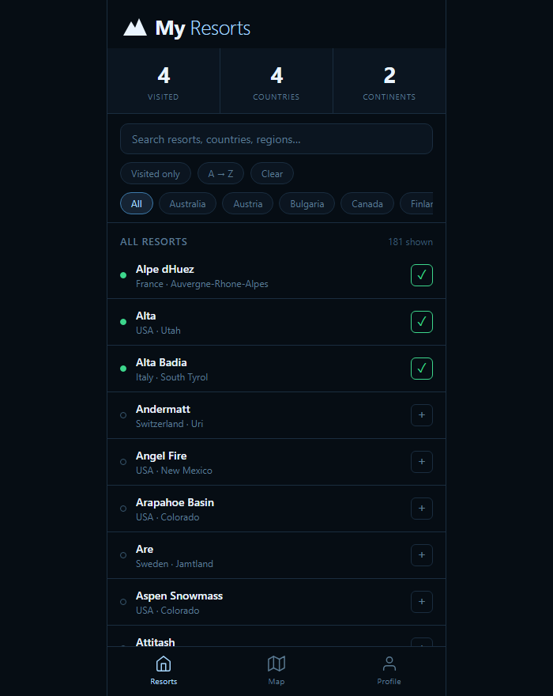

# Powder — Ski Resort Tracker

A dark-themed tracker for logging the ski resorts you've visited across 181 resorts in 17 countries. Search, filter by country, sort, and watch your stats (resorts, countries, continents) update as you check resorts off.

**Live demo:** https://zroessel.github.io/ResortTrackerApp/



## Features

- **Search & filter** — full-text search across name, country, region and description; country chips; "visited only" and "wishlist" toggles
- **Sorting** — A→Z, Z→A, visited first, or unvisited first
- **Wishlist** — star resorts you want to ski, filter to just your wishlist; resorts drop off automatically once visited
- **Live stats** — resorts visited, countries, and continents, recalculated on every change
- **Map & Profile tabs** — breakdown of progress by country and continent
- **Persistence** — saves to a local data file on desktop, or to `localStorage` in the browser

## Tech stack

| Layer | Tech |
|---|---|
| UI | Vanilla HTML, CSS (custom properties), JavaScript — no framework |
| Desktop shell | Electron (main process + `contextBridge` preload with context isolation) |
| Data | Plain-text CSV (`resorts.txt`) read/written via IPC |
| Web build | Same `index.html`, with a fallback data layer using `fetch` + `localStorage` |
| Prototype | Original JavaFX version in [`src/App.java`](src/App.java) |

## Architecture

The UI talks to a small `window.api` interface (`loadResorts`, `saveResorts`), so it doesn't care where data lives:

- **Electron:** [`preload.js`](preload.js) exposes `window.api` through `contextBridge`; [`main.js`](main.js) handles the IPC calls and reads/writes `resorts.txt` with Node's `fs`. The renderer never gets direct Node access.
- **Browser:** if `window.api` isn't present, [`index.html`](index.html) installs a fallback that fetches `resorts.txt` over HTTP and stores changes in `localStorage`. This is what powers the GitHub Pages demo.

## Running locally

**In the browser**

```bash
npx http-server -p 8080 .
# open http://localhost:8080
```

**As a desktop app**

```bash
npm install
npm start
```

## What I learned

- Separating the UI from storage behind a small interface so one codebase runs as both a desktop app and a static website
- Electron's security model: context isolation and exposing only a minimal IPC surface through a preload script
- Porting a JavaFX prototype to web technologies
